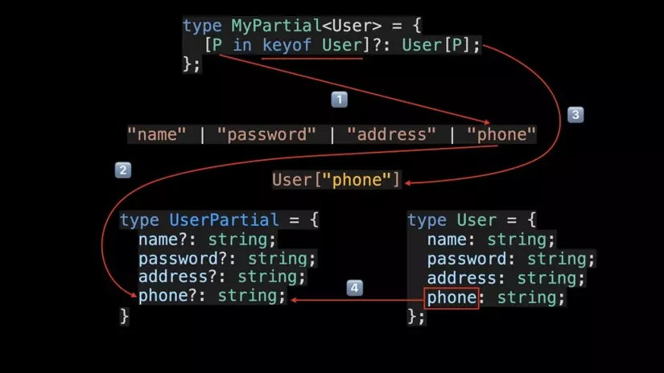
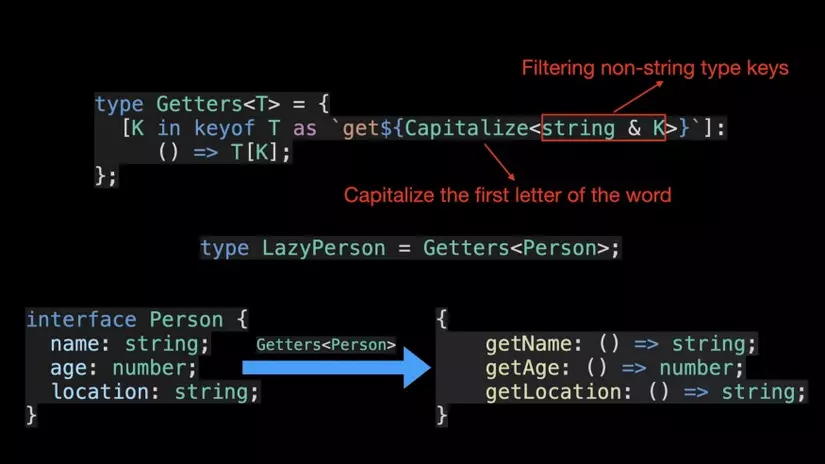

# TypeScript

Nguồn: [W3Schools TypeScript Tutorial](https://www.w3schools.com/typescript/).

## Bắt đầu

- TypeScript (TS) mở rộng JavaScript bằng hệ thống kiểu DL; trình biên dịch kiểm tra kiểu và chuyển TS thành JS. Kiểu bị xóa khi chạy, không tự kiểm tra dữ liệu từ bên ngoài.
- `tsc file.ts` biên dịch; `tsc --noEmit` chỉ kiểm tra; `tsc --init` tạo `tsconfig.json`. 
- Nên bật `strict: true`, chọn `target`, `module`, `rootDir`, `outDir` phù hợp và tránh đưa mã sinh ra vào source.
  
- Trong dự án: `npm install -D typescript`, rồi dùng `npx tsc`. Thư viện JS thiếu khai báo kiểu có thể cần `npm install -D @types/<ten>` (DefinitelyTyped).

## Kiểu cơ bản và suy luận

```ts
let name: string = "An";          // khai báo tường minh
let age = 20;                    // suy luận là number, vẫn được kiểm tra kiểu
let active: boolean = true;
let value: string | number = 1;
```

- Kiểu cơ bản: `string`, `number`, `boolean`, `bigint`, `symbol`, `null`, `undefined`.
- `any`: bỏ kiểm tra kiểu; hạn chế dùng. `unknown`: nhận mọi giá trị nhưng phải kiểm tra/thu hẹp kiểu trước khi sử dụng. `never`: giá trị không thể xảy ra, ví dụ hàm luôn ném lỗi. `void`: hàm không trả về giá trị hữu ích.
- `strictNullChecks` giúp phát hiện `null`/`undefined`; dùng `?.` để truy cập an toàn và `??` để đặt mặc định khi giá trị là nullish.

## Array, tuple, object, enum

```ts
const scores: number[] = [8, 9];
const fixed: readonly number[] = [1, 2]; // không sửa qua tham chiếu này
const point: [number, number] = [10, 20];
const user: { readonly id: number; name: string; email?: string } = { id: 1, name: "An" };
enum Role { Student = "student", Teacher = "teacher" }
```

- Array chứa phần tử cùng kiểu; tuple mô tả kiểu và thứ tự từng vị trí. Tuple thông thường vẫn là mảng lúc chạy; dùng `readonly` để tránh sửa qua kiểu đó.
- `?` đánh dấu thuộc tính tùy chọn; `readonly` chỉ kiểm tra khi biên dịch, không đóng băng object lúc chạy. Enum đặt tên cho tập hằng số; union literal thường đủ khi chỉ cần tập giá trị.

## Alias, interface, union và literal

```ts
type Status = "pending" | "active" | "done"; // union của các literal
interface Person { id: number; name: string }
interface Student extends Person { grade: number }
type Named = { name: string };
type Employee = Named & { salary: number }; // intersection: kết hợp kiểu
```

- `type` đặt bí danh cho mọi kiểu; `interface` thường mô tả object và có thể `extends`. Interface cùng tên có thể gộp khai báo; type alias không hỗ trợ cách gộp này.
- Union (`A | B`) nhận một trong các kiểu; cần thu hẹp trước khi dùng thành viên chỉ có ở một nhánh.

## Hàm

```ts
function greet(name: string, title = "Bạn"): string { return `${title} ${name}`; }
function sum(...values: number[]): number { return values.reduce((a, b) => a + b, 0); }
function log(message?: string): void { console.log(message); }
type Operation = (a: number, b: number) => number;
```

- Chú thích tham số và kiểu trả về khi hữu ích; `?` là tham số tùy chọn, giá trị mặc định làm tham số có thể bỏ qua, `...` nhận nhiều đối số. TS cũng hỗ trợ overload cho nhiều cách gọi.

## Thu hẹp kiểu và assertion

```ts
function show(value: string | number): string {
  return typeof value === "string" ? value.toUpperCase() : value.toFixed(2);
}
function isPerson(value: unknown): value is Person {
  return typeof value === "object" && value !== null &&
    "id" in value && typeof value.id === "number" &&
    "name" in value && typeof value.name === "string";
}
```

- Type guard dùng `typeof`, `instanceof`, `in`, so sánh literal hoặc hàm `value is Type`. Kiểm tra dữ liệu không tin cậy trước khi dùng.
- `value as Type` và `!` (non-null assertion) chỉ khẳng định với trình biên dịch, không chuyển đổi hay kiểm tra giá trị lúc chạy; dùng thận trọng.

## Class

```ts
class Account {
  constructor(public readonly id: number, private balance: number) {}
  deposit(amount: number): void { this.balance += amount; }
  getBalance(): number { return this.balance; }
}
```

- `public`, `protected`, `private` quy định quyền truy cập theo TS; `readonly` ngăn gán lại. Class có thể `extends` class khác và `implements` interface; `abstract` mô tả lớp chưa hoàn chỉnh. Nếu cần tính riêng tư lúc chạy, dùng trường JavaScript `#field`.

## Generics, keyof và index signature

```ts
function identity<T>(value: T): T { return value; }
function get<T, K extends keyof T>(obj: T, key: K): T[K] { return obj[key]; }
type Scores = { [name: string]: number };
```

- Generic giữ quan hệ giữa các kiểu; `T extends ...` đặt ràng buộc. `keyof T` tạo union các khóa; `T[K]` lấy kiểu giá trị tại khóa. Index signature mô tả các khóa động cùng kiểu giá trị.

## Utility, mapped và conditional types

```ts
interface User { id: number; name: string; email?: string }
type Update = Partial<User>;                 // tất cả tùy chọn
type Complete = Required<User>;              // tất cả bắt buộc
type View = Pick<User, "id" | "name">;
type NoEmail = Omit<User, "email">;
type Flags = Record<"read" | "write", boolean>;
type Immutable = Readonly<User>;             // chỉ readonly mức nông
type WithoutDone = Exclude<Status, "done">;
type Result = ReturnType<typeof greet>;
type Args = Parameters<typeof greet>;
type MyPartial<T> = { [K in keyof T]?: T[K] };
type ElementOf<T> = T extends (infer U)[] ? U : T;
```

- Mapped type duyệt các khóa để tạo kiểu mới; có thể thêm/bỏ `readonly`, `?` hoặc đổi tên khóa bằng `as`. Utility types tận dụng các phép biến đổi này để tránh khai báo lặp.
- Conditional type `T extends U ? X : Y` chọn kiểu theo điều kiện; `infer` suy luận một kiểu bên trong điều kiện.






## Module, async và xử lý lỗi

```ts
// math.ts: export function add(a: number, b: number) { return a + b; }
// main.ts: import { add } from "./math";
async function loadName(): Promise<string> { 
  return "An"; 
  }
async function main(): Promise<void> {
  try { 
    console.log(await loadName()); 
    }
  catch (error: unknown) { 
    console.error(error instanceof Error ? error.message : error); 
    }
}
```

- `export`/`import` chia mã thành module; cấu hình module và môi trường chạy phải tương thích. `async` trả về `Promise`; dùng `await` trong `try/catch` để xử lý lỗi.
- TS dùng được với Node.js, React và dự án JS; có thể chuyển dần bằng `allowJs`/`checkJs` và JSDoc. Namespace, declaration merging và decorators hữu ích trong một số trường hợp chuyên biệt; ưu tiên module cho mã mới.

## Bài lab

Các file trong `TS/labs` có ví dụ chạy được và yêu cầu thử thêm trong comment:

1. `01-types.ts`: kiểu cơ bản, array, tuple, `unknown`.
2. `02-objects-unions.ts`: object, enum, union, null.
3. `03-functions.ts`: tham số và hàm.
4. `04-classes.ts`: class và interface.
5. `05-generics-utilities.ts`: generics, utility và mapped types.
6. `06-narrowing.ts`: kiểm tra dữ liệu ngoài và thu hẹp kiểu.
7. `07-async.ts`: module, async/await và xử lý lỗi.

Chạy từ thư mục gốc dự án (cần TypeScript và Node.js):

```powershell
tsc -p TS/labs
node TS/labs/dist/01-types.js  # thay tên file để chạy lab khác
```
